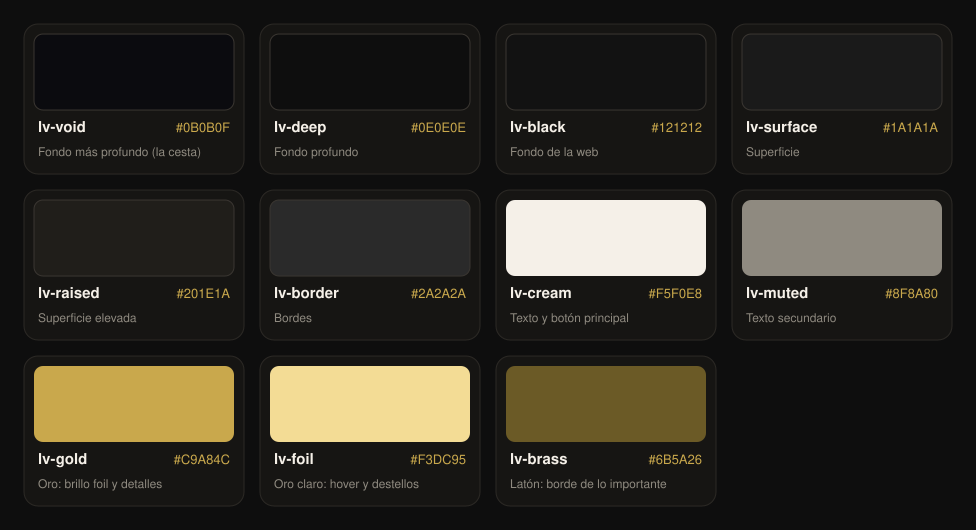

# Color

Fuente de verdad: `tailwind.config.js` → `theme.extend.colors`. En plantillas se usan siempre las clases
(`bg-lv-black`, `text-lv-cream`…); los hex sueltos solo aparecen en `styles.css` y en los emails, que no pueden usar Tailwind.

*La imagen se regenera con `npm run docs:paleta`.*

## La idea

**Negro cálido + crema + oro de carta foil.** Fondos casi negros con un punto marrón (no azulados), texto crema en
lugar de blanco puro, y el oro como el brillo de una carta rara: se reserva para destacar, no para rellenar.

## Paleta

### Fondos (de más profundo a más claro)

| Token | Hex | Uso |
|---|---|---|
| `lv-void` | `#0B0B0F` | Panel de la cesta y su pie |
| `lv-deep` | `#0E0E0E` | Barra lateral y modales del admin; fondo de página de los emails |
| `lv-black` | `#121212` | **Fondo de la web** (`html`, `body`) y `theme-color` del navegador |
| `lv-surface` | `#1A1A1A` | Superficies: desplegables, paneles, opciones de `<select>` |
| `lv-raised` | `#201E1A` | Superficie elevada cálida. Definido, sin uso actual |
| `lv-border` | `#2A2A2A` | Bordes de campos, desplegables y tarjetas |

Superficies que viven en `styles.css` (no son tokens):

| Nombre | Valor | Uso |
|---|---|---|
| `.liquid-glass` | `#181715` + filete superior de luz | Paneles del checkout y tarjetas de la cesta |
| `.lv-stage` | degradado `#3b362f → #221f1b → #151412` | Fondo de foco de las fotos de producto |

### Texto

| Token | Hex | Uso |
|---|---|---|
| `lv-cream` | `#F5F0E8` | Texto principal, titulares, botón principal |
| `lv-muted` | `#8F8A80` | Texto secundario sólido (etiquetas, ayudas del admin) |

### Oro

| Token | Hex | Uso |
|---|---|---|
| `lv-gold` | `#C9A84C` | Brillo foil, precios, estados activos, bordes seleccionados, foco de teclado, selección de texto |
| `lv-foil` | `#F3DC95` | Hover de enlaces y botones fantasma, destellos, códigos en los emails |
| `lv-brass` | `#6B5A26` | Latón: borde del bloque más importante de un email (el pago); parte oscura del degradado foil |

## Opacidades de crema

El texto secundario de la web es crema con opacidad, no gris. Estas son las que se usan y para qué:

| Clase | Uso | Contraste sobre `lv-black` |
|---|---|---|
| `text-lv-cream` | Texto principal | 16,5:1 (AAA) |
| `text-lv-cream/80`–`/75` | Etiquetas de formulario, texto de apoyo importante | 9,5:1 (AAA) |
| `text-lv-cream/70` | Párrafos secundarios | 8,4:1 (AAA) |
| `text-lv-cream/60` | **El secundario por defecto** (el más usado del proyecto) | 6,5:1 (AA) |
| `.lv-note` (55 %) | Notas pequeñas | 5,6:1 (AA) |
| `/45` | Solo *placeholders* de campos | 4,1:1 (texto grande) |

**No bajar de `/60` en texto que haya que leer.** Por debajo solo para *placeholders* y elementos decorativos.

Bordes y fondos sutiles con blanco translúcido (siempre muy bajos):

- Bordes: `border-white/[0.05]` a `[0.08]`, o `border-lv-cream/10`–`/20`.
- Fondos de campo o fila: `bg-white/[0.02]` a `[0.06]`.

## Contrastes comprobados (WCAG)

| Combinación | Contraste | Nivel |
|---|---|---|
| `lv-cream` sobre `lv-black` | 16,51:1 | AAA |
| `lv-gold` sobre `lv-black` | 8,20:1 | AAA |
| `lv-foil` sobre `lv-black` | 13,81:1 | AAA |
| `lv-black` sobre `lv-gold` (botón oro) | 8,20:1 | AAA |
| `lv-black` sobre `lv-cream` (botón principal) | 16,51:1 | AAA |
| `lv-muted` sobre `lv-black` | 5,46:1 | AA |
| `lv-muted` sobre `lv-surface` | 5,07:1 | AA |
| `lv-gold` sobre `lv-surface` | 7,62:1 | AAA |
| `lv-brass` sobre `lv-black` | 2,78:1 | **No apto para texto** |

`lv-brass` y `lv-border` son solo para bordes y degradados, nunca para texto.

## Colores de estado

No hay tokens propios: se usan los de Tailwind con opacidad baja de fondo.

| Estado | Clases | Ejemplo |
|---|---|---|
| Error | `text-red-400`, `border-red-500/40`, `bg-red-500/[0.06]` | Campo inválido, «Zona no disponible» |
| Correcto / activo (admin) | `bg-emerald-500/80` | Interruptores encendidos del admin |
| Aviso de cupón o envío | `border-lv-gold/30 bg-lv-gold/[0.07]` | Bloque de precio de envío, código aplicado |

## Colores del producto (filamentos)

Los colores que elige el cliente son datos del catálogo (`products.json` → `colors`, se editan en el admin), no colores
de la marca. No se usan en la interfaz salvo en el selector de color.

| Id | Nombre | Hex |
|---|---|---|
| `negro` | Negro | `#1A1A1A` |
| `rojo` | Rojo | `#C12E1F` |
| `verde` | Verde | `#00AE42` |
| `azul` | Azul | `#0A2989` |
| `morado` | Morado | `#5E43B7` |
| `amarillo` | Amarillo | `#F4EE2A` |
| `blanco` | Blanco | `#FFFFFF` |

## Reglas

- **El botón principal es crema, no oro.** El oro se reserva para el brillo foil y los detalles (`lv-btn-gold` existe
  para casos puntuales).
- **Nunca blanco puro** para texto ni fondos de la web: crema `#F5F0E8`. El único `#fff` es el hover del botón principal.
- **Nunca negro puro** de fondo: `lv-black`. El negro puro aplana las fotos y cansa.
- **Un acento por pantalla.** Si todo es dorado, nada destaca.
- **Selección de texto** en oro con texto `lv-black` (`::selection` en `styles.css`).
- **Foco de teclado** siempre visible: contorno oro de 2 px (`:focus-visible`), no se quita nunca.
